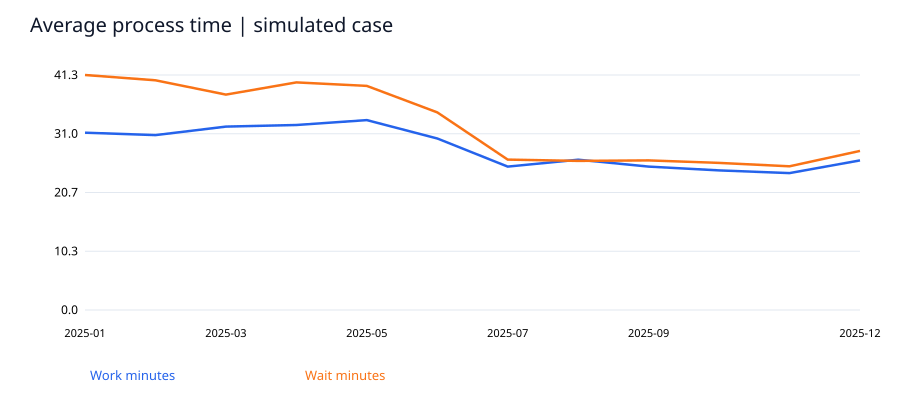
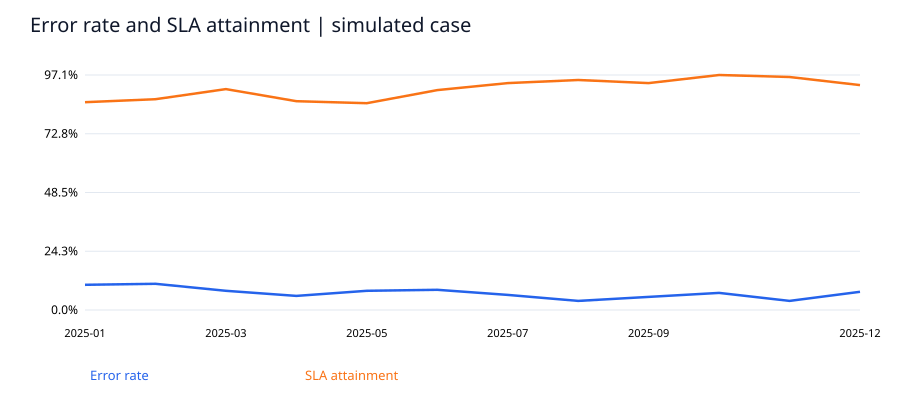

# 業務KPIと処理プロセスの改善分析

模擬データ 個人学習プロジェクト。企業の実績や勤務先のデータを示すものではありません。

## 課題
作業時間と待ち時間を分解し、難易度別に時間と品質の変化を確認できるか。

## 分析方法
データ型・一意性・欠損・時系列を確認し、Pythonで指標を算出。SQLiteで別集計し、件数と主要指標を照合しました。処理結果は results/validation.json に記録しています。

## 主な結果
模擬データ2,880件で、後半期の平均作業時間は前半期比20.2%低い。エラー率は8.5%から5.6%。改善を仮定した生成条件が結果に含まれるため、実証された業務効果ではない。

## 改善提案
Complex案件を優先して受付チェックリストと承認ルールを試行する。実務では件数、複雑度、担当者、流入時刻を記録し、比較対象を置いた小規模パイロットで品質と時間の両面を確認する。

## 追加の検証と解釈
前半期の難易度構成を固定した平均作業時間の減少率は18.2%。難易度・期内の行を独立に再抽出する1000回のブートストラップ区間は16.1%–20.2%。固定した構成比と独立行という仮定に条件づけた区間であり、日次相関や交絡は評価していない。模擬生成の効果を現実の因果効果へ一般化できない。

## 解釈上の制約
完全な模擬ケース。2025年の各月240件の完了タスクのみ。待ち時間は暦上の経過分。未完了案件や稼働人数がないため、バックログや一人当たり生産性は算出しない。Before/Afterは季節・担当者差の影響を排除できず、因果効果とみなせない。

## 再現手順
Python 3.11以降で `python -m pip install -r requirements.txt` を実行後、`python analyze.py`。ダウンロード不要で同梱データから再現できます。固定seed=20261030。出力先は本フォルダー。分析処理は入力データを変更しません（模擬ケースのraw.csvは生成し直します）。

## 成果物
- report.html：ブラウザーで閲覧可能な分析レポート
- data/fact.csv と DICTIONARY.md：分析用データと定義
- analyze.py：生成・加工・分析・検証の実行コード
- analysis.sql と results/analysis.sqlite：実行済みSQLとDB
- charts/：SVGグラフ
- powerbi/：DAXとDesktop構築仕様（PBIX未作成）

使用技術：Python、Pandas、NumPy、SQLite、SVG。Power BIは設計のみで、実装済みスキルとしては記載していません。

## 図表プレビュー

HTMLレポートはこのリポジトリをダウンロード・展開し、`report.html` をブラウザーで開くと閲覧できます。
